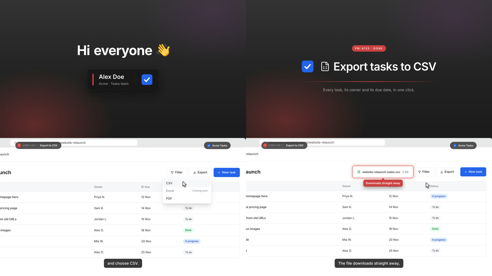

# done-video

A Claude skill that makes narrated, animated **Done videos** and feature demos as code.

You tell Claude what you finished. It writes a script for you to approve, then rebuilds your product's real screens as React scenes. A cursor and camera act out the feature on cue with the voiceover, and the result renders to a 1080p MP4 with captions, sound effects and music. Nothing is screen-recorded, so the video is the same every time and changing a line of the script re-times the whole thing.



## Install

With [`npx skills`](https://github.com/vercel-labs/skills), for Claude Code, Claude Desktop and other coding agents:

```bash
npx skills add tino-liu/done-video -g
```

Or as a Claude Code plugin:

```bash
claude plugin marketplace add tino-liu/done-video
claude plugin install done-video@tino-liu
```

## Use

Ask Claude for a Done video, for example:

> Make a done video for PBI #123, export tasks to CSV. I'm presenting.

Claude reads the PBI and your product's UI code, drafts the script for you to approve, builds the scenes, checks stills, and renders `out/done-video.mp4`. It asks before anything that costs money or needs your keys.

## Requirements

- Node.js 20+
- `ffmpeg` and `ffprobe` on your PATH (`brew install ffmpeg`, `winget install ffmpeg`, or your package manager)
- Google Chrome, which does the frame rendering

**For the voice**, either:

- An [ElevenLabs](https://elevenlabs.io) API key and voice ID, from your own voice clone or any stock voice. You paste them into the video project's `.env` yourself; they are never shared in the chat.
- Nothing: your computer's built-in voice works as a placeholder (macOS `say`, Windows SAPI, or `espeak-ng` on Linux).

## How it works

```
scripts/scenes.mjs  ──npm run voice──▶  voice clips + src/timeline.json (when each word is spoken)
src/scenes/*.tsx    ──cued on those words──▶  every frame is a pure function of its frame number
npm run mix         ──▶  voice + UI sound effects + ducked music bed, −16 LUFS
npm run render      ──▶  headless Chrome screenshots each frame in parallel → ffmpeg → MP4
```

The skill's instructions are in [`skills/done-video/SKILL.md`](skills/done-video/SKILL.md), and the starting project is in [`skills/done-video/template`](skills/done-video/template).

## License

MIT
