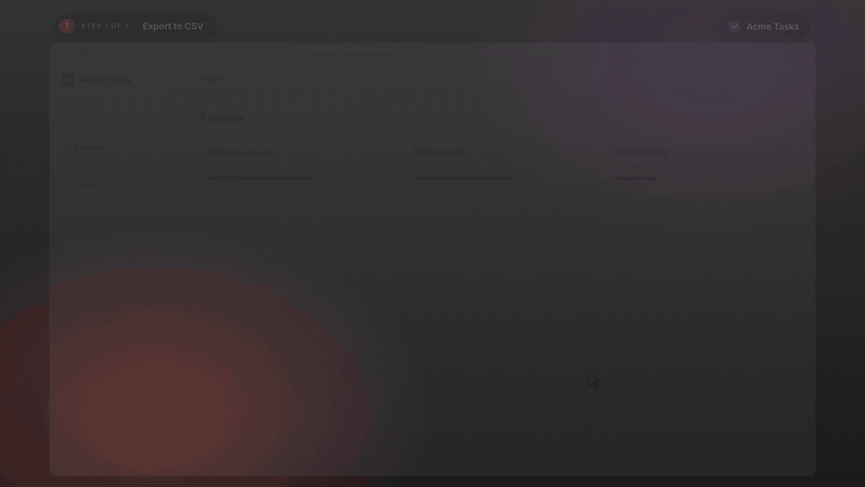
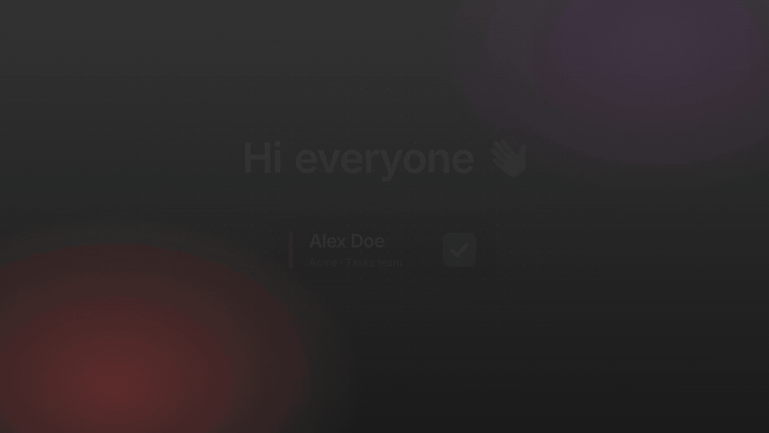
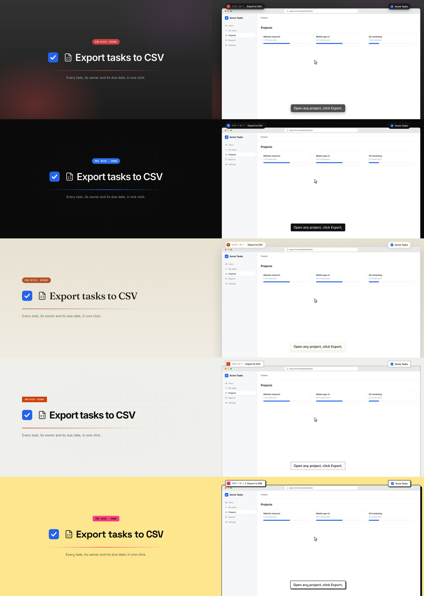

# done-video

A Claude skill that makes narrated, animated **Done videos** and feature demos as code.

You tell Claude what you finished. It writes a script for you to approve, then rebuilds your product's real screens as React scenes, styled to your design system. A cursor and camera act out the feature on cue with the voiceover, and the result renders to a 1080p MP4 with captions, sound effects and music. Nothing is screen-recorded, so the video is the same every time and changing a line of the script re-times the whole thing. Each rebuilt screen is checked against a screenshot of your real page, laid over it, so it matches the product.



The whole example, with sound:

https://github.com/user-attachments/assets/8b1e014f-2143-4118-a0b2-5409066f1a49

## Install

With [`npx skills`](https://github.com/vercel-labs/skills), for Claude Code, Claude Desktop and other coding agents:

```bash
npx skills add tino-liu/done-video -g
```

Or as a Claude Code plugin:

```bash
claude plugin marketplace add tino-liu/done-video
claude plugin install done-video@tino-liu
```

## Use

Ask Claude for a Done video, for example:

> Make a done video for PBI #123, export tasks to CSV. I'm presenting.

Claude reads the PBI and your product's UI code, drafts the script for you to approve, captures your real pages, rebuilds them and checks them against the captures, builds the scenes, checks stills, and renders `out/done-video.mp4`. Then it reviews the whole video, every frame and the soundtrack, and fixes what it finds before handing it over: stray sounds and static after a line, glitched frames, camera jumps, a cut-off ending. If a page needs a sign-in, Chrome opens for you to sign in yourself. It asks before anything that costs money or needs your keys.

## Your design system

The look around your product's screens comes from a **theme**: the backdrop, the title cards, captions and callouts, the type, the corners and shadows, and how things move. Tell Claude where your design system is, in the same message or when it asks, and it maps it to a theme. There's no format to convert to:

> Make a done video for PBI #456, the new invoice filters. Use our design system in `../acme-design-system`.

> Done video for issue #88. Our design tokens are in `packages/tokens/tokens.json`.

> Make it look like our website, https://acme.example

> Re-theme this video with the brand guide in `docs/brand-guidelines.pdf`.

Claude can read:

- **Files:** a tokens file (W3C, Tokens Studio or Style Dictionary JSON), a Tailwind config, CSS variables, or a component library's theme.
- **A design system package** in your repo or `node_modules`.
- **Docs:** a design system site, a `DESIGN.md`, or a brand guidelines PDF.
- **Your product's code.** When the video is about a product Claude can read the code of, its stylesheets usually are the design system, and Claude finds them while it studies the screens.

Some sources need a little more from you:

- **Figma.** Export the variables to JSON or share screenshots, unless Claude has a Figma connection.
- **Licensed brand fonts.** Supply the font files; otherwise Claude uses the closest open font and tells you which.
- **Private packages and repos.** Your machine needs access already.

Claude checks the contrast and shows you stills before it builds anything. Where the design system leaves a choice open, such as light or dark, it shows both and you pick. Your product's own screens always keep the product's look.

Without a design system, start from a preset and change the accent colour:

> Use the midnight theme with our blue, #0F62FE.





In order: `aurora` (dark, brand glows, springy), `midnight` (dark, minimal, developer tool), `paper` (light, editorial, serif), `swiss` (flat, square, functional) and `brutal` (thick borders, hard shadows).

## Requirements

- Node.js 20+
- `ffmpeg` and `ffprobe` on your PATH (`brew install ffmpeg`, `winget install ffmpeg`, or your package manager)
- Google Chrome, which does the frame rendering

**For the voice**, either:

- An [ElevenLabs](https://elevenlabs.io) API key and voice ID, from your own voice clone or any stock voice. You paste them into the video project's `.env` yourself; they are never shared in the chat.
- Nothing: your computer's built-in voice works as a placeholder (macOS `say`, Windows SAPI, or `espeak-ng` on Linux).

## How it works

```
scripts/scenes.mjs  ──npm run voice──▶  voice clips + src/timeline.json (when each word is spoken)
src/themes/*.json   ──your design system──▶  colours, type, corners, backdrop and motion
scripts/capture.mjs ──your real pages──▶  screenshots each rebuilt screen is checked against
src/scenes/*.tsx    ──cued on those words──▶  every frame is a pure function of its frame number
npm run mix         ──▶  cleaned-up voice + UI sound effects + ducked music bed, −16 LUFS
npm run render      ──▶  headless Chrome screenshots each frame in parallel → ffmpeg → MP4
npm run review      ──▶  every frame and the soundtrack checked, plus a contact sheet of each scene
```

The skill's instructions are in [`skills/done-video/SKILL.md`](skills/done-video/SKILL.md), and the starting project is in [`skills/done-video/template`](skills/done-video/template).

## License

MIT
